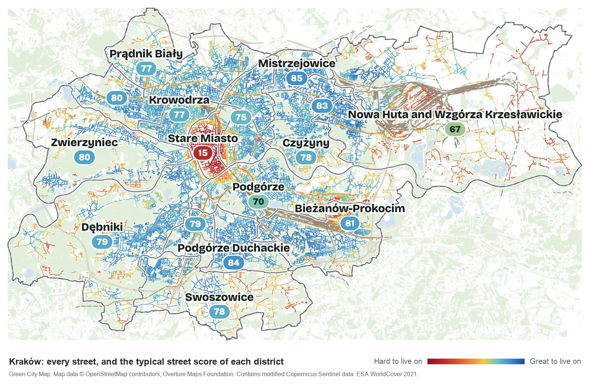
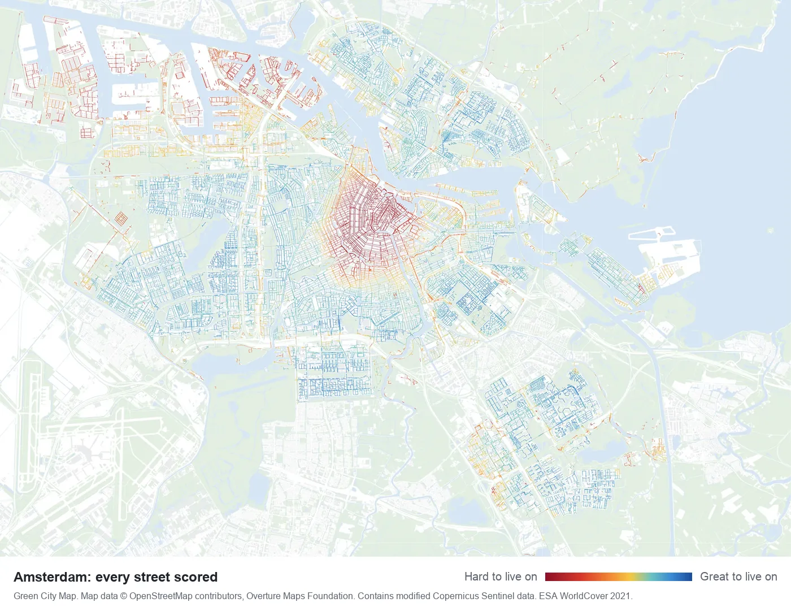
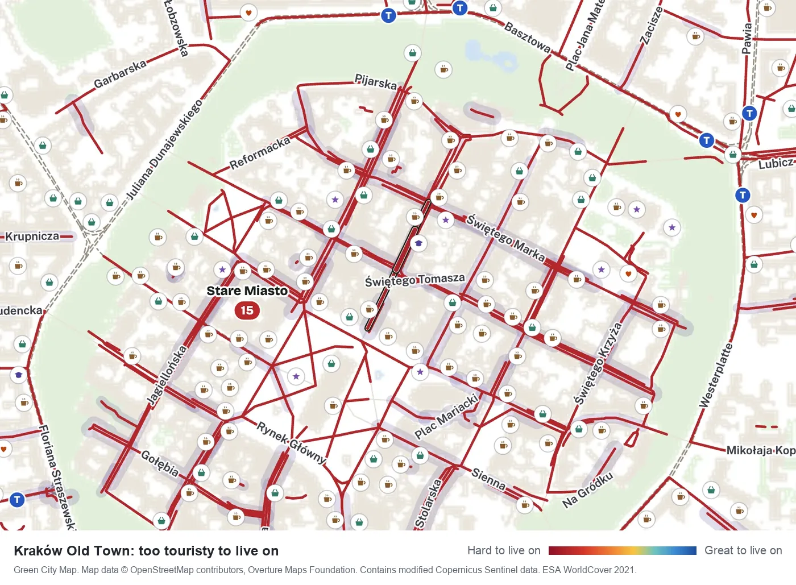

# Green City Map

A street livability score for any city. Every residential street is scored from 0 to 100 for light, green space, noise, tourists and walkability to daily needs, using OpenStreetMap and other open data. It runs as an AI agent skill on your own computer.

See the map: **https://greencitymap.city**



## What it scores

Each street gets six part scores. The overall score combines them.

| Part | What it measures | Made from |
|---|---|---|
| **View and openness** | How far away the building opposite is, and how much sky it hides from a first-floor window | Overture building outlines and heights |
| **Green** | Trees and planted ground along the street and within 300 to 500 m | Copernicus Sentinel-2, ESA WorldCover |
| **Nature** | Walking distance to parks and woods, from small parks nearby to large forests further away | Overture land use (from OpenStreetMap), checked with Sentinel-2 |
| **Quiet** | Estimated road and rail noise | Overture road types, and the buildings in between |
| **Few tourists** | How many sights, hotels and hostels are nearby | Overture places |
| **Life without a car** | Public transport, and walking time to groceries, cafés, a pharmacy, a doctor, a school, culture and sport | OpenStreetMap, Overture places |

Areas get scores too, so you can see the best areas to live in a city, and why. Each district gets the score of its typical street, plus three extra scores: good for families, easy on foot, and safety. Safety combines our street estimate (traffic, crossings, lighting) with police records where they are open, the Hoodmaps crowd map, and regional figures from Eurostat. Each source comes with a note on how far to trust it. Safety never changes the map colours or the main score.

## Use it with an AI agent

Paste this into Claude Code, or any coding agent that can run shell commands:

> Install the Green City Map skill from github.com/broAir/green-city-map and map Ljubljana.

The agent clones this repository, follows [skill/SKILL.md](skill/SKILL.md), and walks you through each step. It shows you the map before anything is shared, and nothing is sent anywhere until you approve it in your browser.

If you open a clone of this repository in an agent, [AGENTS.md](AGENTS.md) (and [CLAUDE.md](CLAUDE.md) for Claude Code) points it to the skill.

### Install as a skill

To keep the skill installed in Claude Code, pick one of these.

As a plugin, typed inside Claude Code:

```
/plugin marketplace add broAir/green-city-map
/plugin install green-city-map@green-city-map
```

Or as a personal skill linked to a clone, on macOS or Linux:

```sh
git clone https://github.com/broAir/green-city-map
cd green-city-map
mkdir -p ~/.claude/skills
ln -s "$PWD/skill" ~/.claude/skills/green-city-map
```

With the link, the agent works in that clone. With the plugin, it asks you where to clone the repository. Allow about 1 GB of free space for the Python environment and the downloads.

Opening a clone in Claude Code works too: the clone holds the skill in `.claude/skills/`.

## Run it yourself

You need bash, git and Python 3.12 or newer. It was built on macOS; Linux should work, and on Windows use WSL.

- On macOS the built-in `python3` is too old. Install a newer one first, for example with `brew install python@3.12`.
- On Debian or Ubuntu, also install the matching `venv` package (for example `python3.12-venv`), or `setup.sh` can't create the environment.
- If `python3` isn't 3.12 or newer, tell `setup.sh` which Python to use: `PYTHON=python3.12 skill/setup.sh`.

Set up once, find the city, then run it:

```sh
git clone https://github.com/broAir/green-city-map
cd green-city-map
skill/setup.sh
.venv/bin/python -I skill/pipeline/resolve_city.py "Ljubljana" SI --write
skill/run_city.sh si/ljubljana
```

- `setup.sh` makes a Python environment in `.venv` (about 600 MB).
- `resolve_city.py` finds the city boundary and writes `registry/si/ljubljana/sources.yaml`.
- `run_city.sh` takes 5 to 10 minutes and downloads 150 to 450 MB.

Look at the result on a local map:

```sh
.venv/bin/python -I skill/viewer/build_review.py skill/config/street_metrics.yaml out review "first look" ljubljana
.venv/bin/python -I -m http.server 8000 --bind 127.0.0.1 --directory review
```

Then open <http://localhost:8000> in your browser. Press Ctrl+C in the terminal to stop the server.

Pack the city into `share/si-ljubljana.gcm.zip`, then send it to the website, https://greencitymap.city:

```sh
.venv/bin/python -I skill/pipeline/package_city.py out/ljubljana share --credit "Your name"
.venv/bin/python -I skill/pipeline/submit_city.py share/si-ljubljana.gcm.zip
```

The credit is optional. `submit_city.py` prints a link and a short code. Open the link and click "Yes, send it"; only then is the file uploaded.

The website answers with a receipt, which the script saves in `.submissions/`. It then prints the steps for a pull request that adds that one file to this repository. Open it only if you want to: it is public and shows your GitHub name. The site owner checks the upload against the receipt before the city goes on the map. How this works, and what the bundle holds, is in [docs/UPLOAD.md](docs/UPLOAD.md).

Bundles attached to GitHub issues are never put on the map; the upload above is the only way in.

## Cities mapped so far

| City | Registry folder | Street pieces scored | Districts |
|---|---|---|---|
| Kraków | [registry/pl/krakow](registry/pl/krakow) | 50,846 | 17 |
| Warsaw (Warszawa) | [registry/pl/warszawa](registry/pl/warszawa) | 90,196 | 18 |
| Amsterdam | [registry/nl/amsterdam](registry/nl/amsterdam) | 45,740 | 8 |
| Lisbon (Lisboa) | [registry/pt/lisboa](registry/pt/lisboa) | 29,253 | 24 |
| Ljubljana | [registry/si/ljubljana](registry/si/ljubljana) | 24,401 | 14 |
| Dnipro | [registry/ua/dnipro](registry/ua/dnipro) | 60,276 | 8 |

A street piece is up to 60 m of one street. All six cities use the Overture Maps release of 23 September 2026. In Ljubljana and Dnipro only about 8% of buildings have a measured height, so views there rest more on estimates.

This repository holds each city's source list, not the results, which are large. Run the skill to make them.



## How the scoring works

In short:

1. Every street is cut into pieces of up to 60 m. Every 15 m, the pipeline looks across the street: how far to the building opposite, how tall it is, how much is green in between.
2. Area values, such as tree cover within 300 m or the number of tourist places nearby, are read at the middle of each piece. Walking distances use the real street network.
3. Each value becomes a score from 0 (bad) to 100 (good). Most use fixed bands, so scores compare across cities. A few are ranked within the city and are marked "relative".
4. The six parts are averaged with equal weights. Green can carry at most 30% of the total.
5. Three parts are deal-breakers. A street can't score more than 10 above its tourism score, 35 above its noise score, or 20 above its "life without a car" score. A pretty, quiet street in a tourist hotspot is still hard to live on.



The details:

- [spec/street-heatmap.md](spec/street-heatmap.md): how a street becomes numbers and a colour.
- [spec/metrics.md](spec/metrics.md): every measure, and why it matters for daily life.
- [spec/input-layers.md](spec/input-layers.md): the data sources, and which licences are allowed.
- [skill/config/street_metrics.yaml](skill/config/street_metrics.yaml): every threshold and weight.

## Data sources

| Source | Used for | Licence |
|---|---|---|
| [OpenStreetMap](https://www.openstreetmap.org/copyright) | Public transport, everyday places, districts, street lighting | ODbL 1.0 |
| [Overture Maps](https://overturemaps.org) | City boundary, buildings and heights, streets, places, parks | ODbL 1.0; places under their providers' open licences |
| [Copernicus Sentinel-2](https://dataspace.copernicus.eu), via Microsoft Planetary Computer | Summer greenness | Copernicus open data terms |
| [ESA WorldCover 2021](https://esa-worldcover.org) | Tree cover and built-up land | CC BY 4.0 |

District safety can also use police data where it is open (the Netherlands and the United Kingdom today), Eurostat, the Hoodmaps crowd map, and, with your own keys, Reddit and Numbeo.

It never uses Google, Apple or Bing map services, Street View or their satellite images. Overture's open data does include some building outlines, heights and places that Microsoft and Google published under open licences; [DATA_LICENSE.md](DATA_LICENSE.md) credits them.

## Licences

- **Code** (the skill, spec and docs): free for non-commercial use under the [PolyForm Noncommercial License 1.0.0](LICENSE.md). It is source-available, not OSI open source.
- **City data** (the outputs in `out/<city>/` and the `.gcm.zip` bundles): [Open Database License 1.0](DATA_LICENSE.md), like OpenStreetMap. Anyone may use it, including commercially, with credit. The one exception is the crowd and survey part of district safety (Hoodmaps, Reddit, Numbeo), which keeps its sources' own terms.

Anything that shows the city data must credit: © OpenStreetMap contributors, © Overture Maps Foundation, "Contains modified Copernicus Sentinel data", and ESA WorldCover 2021 (CC BY 4.0). [DATA_LICENSE.md](DATA_LICENSE.md) has the full list, including the credits Overture asks for, and explains why the data can't be non-commercial only.

## Honest limits

Scores are estimates made by a computer from open data, and they can be wrong or out of date. Noise is estimated from road types, not measured. Single street trees are too small for the satellite pictures. Places with sparse OpenStreetMap mapping look worse served than they are. The map says nothing about rents, prices or schools. It is no substitute for visiting a street.

## Contributing

You can map a new city, add better local data for a city, report a score that looks wrong, or improve the code. See [CONTRIBUTING.md](CONTRIBUTING.md).

A new city reaches the map in two steps. First the bundle is uploaded to the website, and a person approves the upload in the browser. Then a pull request adds the upload's receipt to [.submissions/](.submissions). A GitHub check tests that receipt, and the site owner checks the upload against it, publishes the city and merges the pull request. Your agent asks you before it opens the pull request.

## Citing

If you use Green City Map in research or writing, please cite it. The details are in [CITATION.cff](CITATION.cff); GitHub's "Cite this repository" button gives them in APA and BibTeX.

## What is where

| Path | What it is |
|---|---|
| [skill/](skill) | The skill: [SKILL.md](skill/SKILL.md) (instructions for the agent), `pipeline/` (download, measure, score, check, pack, send), `viewer/` (the review map and previews), `config/` (every threshold) |
| [spec/](spec) | What is measured and why |
| [registry/](registry) | Per city: `sources.yaml` (what the run used) and `candidates.yaml` (better local data found) |
| [docs/](docs) | [UPLOAD.md](docs/UPLOAD.md) (how a city reaches the website) and the README pictures |
| [.submissions/](.submissions) | One receipt per uploaded city, each added by its own pull request |
| [.github/](.github) | Issue forms, the checks that run on pull requests, code owners and Dependabot settings |
| [.claude-plugin/](.claude-plugin) and [.claude/skills/](.claude/skills) | Let Claude Code install the skill as a plugin (the plugin is the `skill/` folder only), or find it in a clone |
